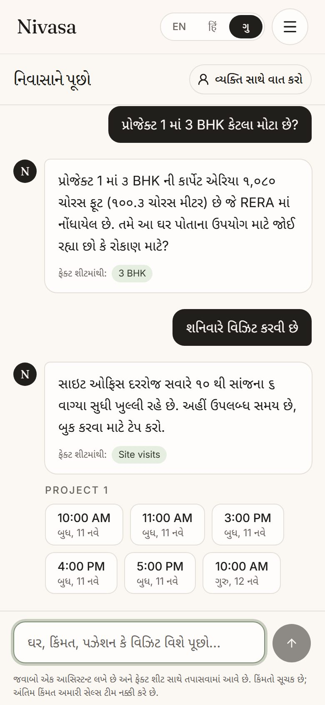
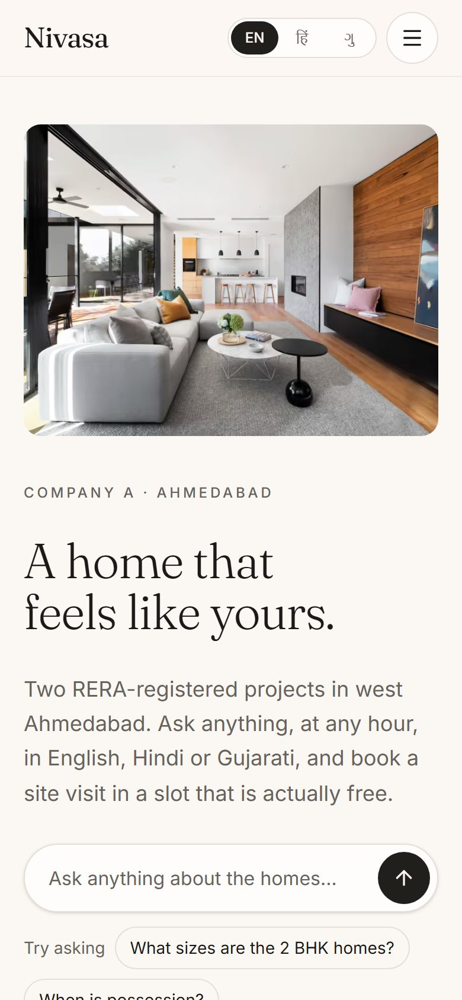
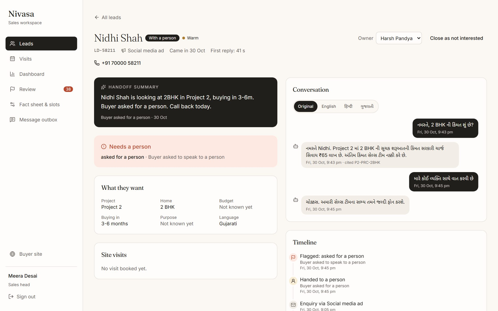

# Nivasa

An AI lead-response and site-visit booking assistant for Company A, a residential developer in Ahmedabad with two live projects.

Every enquiry, from a property portal, a social ad, the website or the hoarding number, lands in one lead list and gets an answer within seconds, at any hour, in English, Hindi or Gujarati. The assistant answers only from the sales head's fact sheet, learns what the buyer wants, and books a site visit in a slot that is actually free. Serious buyers, and anything it can't answer, go to a named sales executive with a summary of the chat.

**Live app:** https://nivasa-delta.vercel.app · **Sales workspace:** https://nivasa-delta.vercel.app/staff

Demo logins and how to run it yourself are in [deployment.md](deployment.md). The design, the decisions behind it and its limits are in the technical design document, [docs/tdd](docs/tdd).

| Buyer chat (Gujarati)                                   | Home page                                               | Lead with handoff summary                                          |
| ------------------------------------------------------- | ------------------------------------------------------- | ------------------------------------------------------------------ |
|  |  |  |

## What it does

**For buyers** (mostly on phones)

- Project pages built from the fact sheet, with the RERA number, homes, amenities, a map pin and the next free visiting times.
- A chat assistant that answers from the fact sheet and shows which fact each answer came from. It never quotes a final price or a discount, and says a person will confirm anything that isn't on the sheet.
- Site-visit booking in three steps, from a project page or inside the chat. The buyer verifies their mobile number with a one-time code and gets a visit pass with a QR code, directions and a calendar file. Reminders go out a day before and two hours before.
- **My visits**, to change or cancel a visit, and a one-tap opt-out of messages.

**For the sales team**

- One lead list from every source, with source tags, scores, duplicate checks, and phone numbers masked until a lead is taken.
- The full chat on each lead, translatable into English, Hindi or Gujarati, and a handoff summary when the assistant passes a buyer on.
- A visits calendar, and QR check-in at the site office to record who actually came.
- A dashboard of response time, reach, visits, show-up rate and cost per visit by source.
- For the sales head: review of flagged chats and possible duplicates, a versioned fact sheet editor, and an editor for visiting times and closed days.

## Built with

Next.js 16 and React 19 · TypeScript · Tailwind CSS · Postgres on Supabase (Mumbai) with Drizzle · Better Auth · Google Gemini through the Vercel AI SDK · next-intl · Vitest and Playwright · deployed on Vercel. Everything runs on free tiers.

## Where things are

```
src/app/[locale]/      buyer pages, in English (/), Hindi (/hi) and Gujarati (/gu)
src/app/staff/         the sales workspace
src/app/api/           chat, lead intake, reminder job, auth
src/server/assistant/  the AI agent, its tools and the checks on every reply
src/server/bookings/   free slots, booking, reminders and check-in
src/server/leads/      intake, duplicates, consent and scoring
src/db/schema.ts       the data model
scripts/seed.ts        realistic sample data, including the three leads from the brief
tests/                 unit, integration, browser tests and the assistant check
docs/                  design document, assumptions, assistant check results
```

## Scripts

```bash
npm run dev          # start locally on http://localhost:3000
npm run db:migrate   # create or update the tables
npm run db:seed      # reset the data to the sample set
npm test             # unit and integration tests
npm run test:e2e     # browser tests on phone and desktop
npm run eval         # 29 conversations against the real model; writes docs/assistant-eval.md
```

Assumptions made where the brief is silent are listed in [docs/assumptions.md](docs/assumptions.md). The latest assistant check is in [docs/assistant-eval.md](docs/assistant-eval.md).
